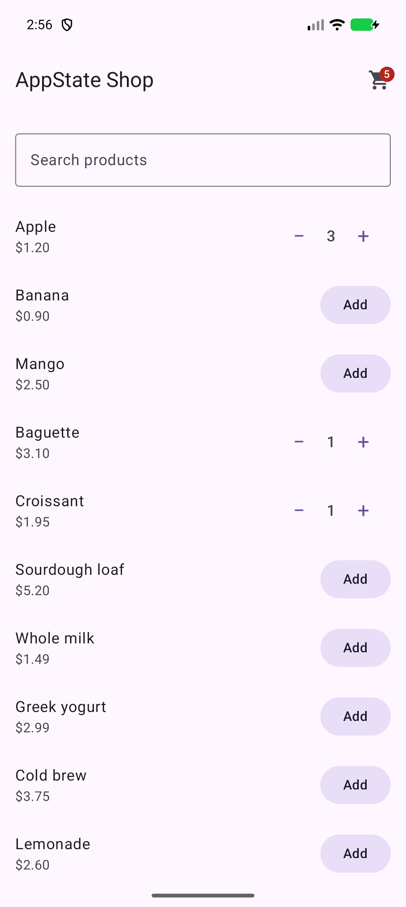
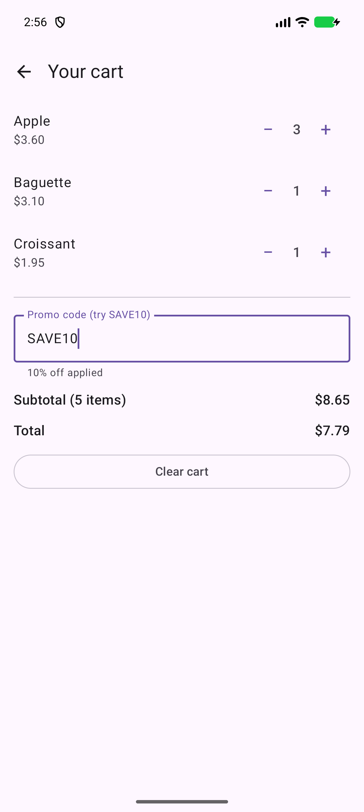

# AppState cart demo

A small Android shop app where **one cart, held in a Jetpack AppState `StateStore`, feeds three places**: a catalog, a cart screen and a top-bar badge. Each place derives its own UI state with **AppState `transform`**. A second catalog ViewModel builds the same state with Flow `combine` + `stateIn`, so the two can be compared side by side.

It's the companion app for the post *One cart, three places: Jetpack AppState Transform vs Flow* (link added on publish).

> AppState is **alpha** (`androidx.appstate` 1.0.0-alpha02). APIs will change. This repo is a learning demo, not production guidance.

| Catalog with badge | Cart with subtotal |
|---|---|
|  |  |

## What's where

| File | What it shows |
|---|---|
| `cart/CartManager.kt` | The cart created once: a private `StateStoreKey` with `PersistToDataStore` |
| `catalog/CatalogViewModel.kt` | `transform` with `remember(key)`, `collectAsState` and a `LaunchedEffect` debounce |
| `catalog/FlowCatalogViewModel.kt` | The same state with `debounce` + `flatMapLatest` + `snapshotFlow` + `stateIn` |
| `cart/CartViewModel.kt` | `return@transform` early exits and a `@Composable` `produceState` helper |
| `ui/ShopApp.kt` | The `@Composable` `transform` overload driving the badge |
| `CartApp.kt` + `data/StateStorePersistence.kt` | `syncToDataStore` persistence, with a reset when a saved value no longer decodes |
| `app/src/test/...` | 20 unit tests: `transformTest` for the transform ViewModels, Turbine for the Flow one |

## Run it

Requires Android Studio Rabbit 1 (2026.2.1) or newer, JDK 21 and the Android SDK (compileSdk 37).

```bash
./gradlew :app:testDebugUnitTest   # 20 tests
./gradlew :app:installDebug        # on a device or emulator
```

## Versions

AGP 9.4.1, Kotlin 2.4.10, Compose BOM 2026.09.00, `androidx.appstate` transform/statestore 1.0.0-alpha02. The full list is in `gradle/libs.versions.toml`.

## License

Apache 2.0. See [`LICENSE`](LICENSE).
